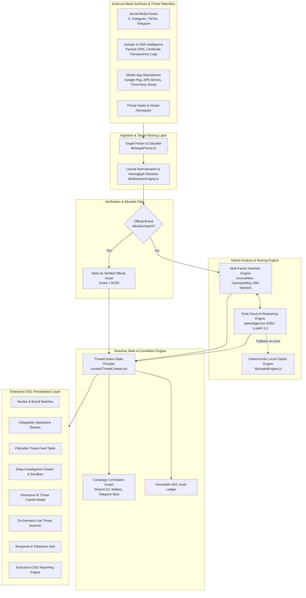
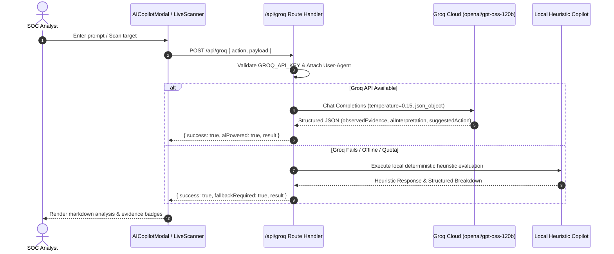
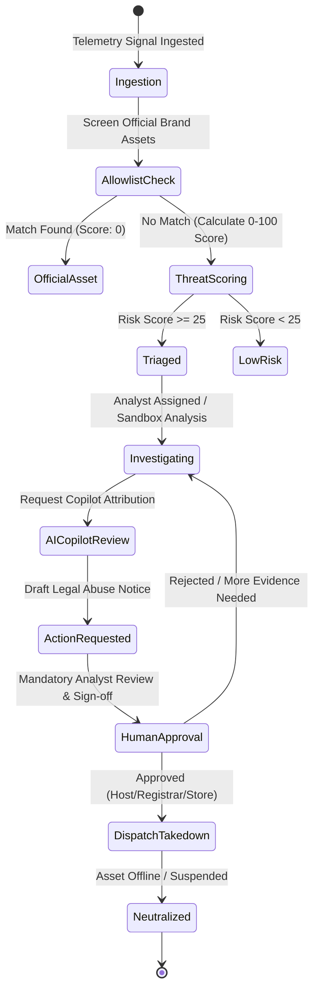

# ScamSentry — System Architecture & Technical Design Document

> **Document Version:** 2.0.0  
> **System:** ScamSentry — AI-Powered Digital Risk Protection Platform (DRPP)  
> **Classification:** Security Operations Center (SOC) Architecture Specification  
> **Repository:** `urjithatalluru-2006/ScamSentry`

---

## 1. Executive Summary & Architectural Vision

**ScamSentry** is an enterprise-grade Digital Risk Protection Platform (DRPP) engineered to discover, investigate, correlate, and neutralize external cyber threats and brand abuse across social media, domain registries, and mobile application ecosystems.

### Core Architectural Principles
1. **Zero-False-Positive Allowlist Gate**: All registered official brand assets (domains, social handles, app package IDs) are screened before threat evaluation, guaranteeing a `0/100` score and `Official Asset` classification.
2. **Deterministic & Explainable Scoring**: Risk scores ($0-100$) are calculated across 5 transparent, mathematically weighted dimensions rather than opaque black-box scoring.
3. **Grounded AI with Human-in-the-Loop**: The AI Threat Investigation Copilot (powered by Groq Cloud high-throughput LLMs) operates strictly over verifiable telemetry. All takedown notices and external platform reports require signed human analyst authorization.
4. **Resilient Dual-Engine Design**: The platform features a cloud AI reasoning engine with autonomous fallback to local heuristic analyzers, ensuring zero downtime if external APIs are unreachable.

---

## 2. High-Level System Architecture Diagram

---

## 3. Layered Architectural Decomposition

### 3.1 Presentation & SOC Control Layer (`src/components/`)
Built with React 19 and Tailwind CSS v4, optimized for low-latency security incident management:
- **Navbar & Workspace Identity** (`Navbar.tsx`): Displays brand emblem, SOC role switcher (`Admin`, `SOC L2 Analyst`, `Investigator`, `Executive`), monitored brand configurator, and real-time backend API connection status.
- **Threat Operations Sidebar** (`Sidebar.tsx`): Categorized navigation across Threat Operations, Investigation & Response, and Assets & Integrations with live badge counts.
- **Threat Intelligence Feed** (`ThreatTable.tsx`): Multi-dimensional filtering by severity (Critical, High, Medium, Low), platform, threat category, and keyword query.
- **Investigation Drawer** (`InvestigationDrawer.tsx`): Full technical dossier featuring:
  - Evidence chain with homoglyph/typosquatting breakdown
  - Air-gapped safe URL sandbox inspecting mock DOM forms and exfiltration targets
  - Linked IOCs (C2 IPs, Nameservers, SSL Fingerprints, Crypto Wallets)
  - One-click RFC/legal takedown dispatch generator
- **AI Copilot Modal** (`AICopilotModal.tsx`): Natural-language assistant grounded in threat telemetry with pre-set CISO queries and copyable responses.
- **Campaign Correlation Graph** (`CampaignGraph.tsx`): Network visualization identifying threat syndicates and coordinated multi-vector campaigns.
- **Brand Asset Manager** (`BrandAssetManager.tsx`): Verified domain, social handle, and app allowlist management.

---

### 3.2 Detection & Risk Scoring Engine (`src/lib/detectionEngine.ts`)

ScamSentry rejects opaque scoring. Every score ($0-100$) is mathematically calculated across five weighted dimensions:

$$\text{Final Risk Score} = W_{\text{sim}} + W_{\text{intent}} + W_{\text{tech}} + W_{\text{radius}} + W_{\text{conf}}$$

| Dimension | Max Points | Evaluation Heuristics |
| :--- | :---: | :--- |
| **Similarity Score** | **25** | Levenshtein distance, Jaro-Winkler ratio, phonetic matching against official brand assets |
| **Deceptive Intent** | **25** | High-risk affixes (`-verify`, `claims`, `login`, `official`, `bonus`, `support`) |
| **Technical Indicators** | **20** | Ephemeral SSL (<72h), intrusive mobile permissions (`READ_SMS`, `BIND_ACCESSIBILITY`), hostile ASN |
| **Impact Radius** | **15** | Audience reach, engagement velocity, credential theft payload presence |
| **Attribution Confidence** | **15** | Corroborating telemetry feeds, domain age, WHOIS privacy proxy indicators |

#### Severity Bands
- **Critical (75–100)**: Active credential harvesting, trojan APKs, direct executive impersonation.
- **High (50–74)**: Deceptive portals, spoofed support handles with off-platform redirection.
- **Medium (25–49)**: Unverified lookalike domains or brand name squatting without payload.
- **Low (0–24)**: Incidental lexical similarities with low risk of user deception.

---

### 3.3 Backend API & AI Intelligence Engine (`src/app/api/groq/route.ts`)

The backend leverages Next.js 16 API Route Handlers integrated with the Groq Cloud API for ultra-low-latency reasoning:

#### Multi-Model Fallback Cascade:
1. `openai/gpt-oss-120b` (Primary ultra-scale reasoning model)
2. `openai/gpt-oss-20b` (High-speed secondary model)
3. `qwen/qwen3.8-27b` (High-capacity alternative)
4. `llama-3.3-70b-versatile` (Standard enterprise LLaMA fallback)

---

### 3.4 State Management & Data Schema (`src/context/`, `src/types/`)

State is managed via `ThreatContext.tsx` with full reactive persistence:
- **`ThreatEntity`**: Core entity representing a detected threat, including severity, status, evidence chain, technical indicators, sandbox telemetry, and case notes.
- **`BrandProfile`**: Monitored organization definition containing official domains, verified social accounts, mobile package names, and sensitivity thresholds.
- **`ThreatCampaign`**: Grouping of related threats into a cohesive threat actor campaign (e.g., *Operation MiragePay*).
- **`AuditEntry`**: Immutable event log tracking every triage action, analyst sign-off, and takedown transmission.

---

## 4. End-to-End Takedown & Response Workflow

---

## 5. Security & SOC 2 Compliance Design

- **Air-Gapped Sandbox**: Safe URL inspection utilizes mock headless DOM extraction without allowing victim client execution or direct network callback exploitation.
- **Role-Based Access Control (RBAC)**: Supports `admin`, `soc_analyst`, `investigator`, and read-only `executive` roles. Takedown dispatches and brand configuration edits require appropriate role authorization.
- **Immutable Audit Trail**: Every status change, note addition, or takedown request logs user identity, timestamp, and action signature.
- **Secret Isolation**: All API credentials reside exclusively on the server side (`.env`), never exposed to client-side bundles.
